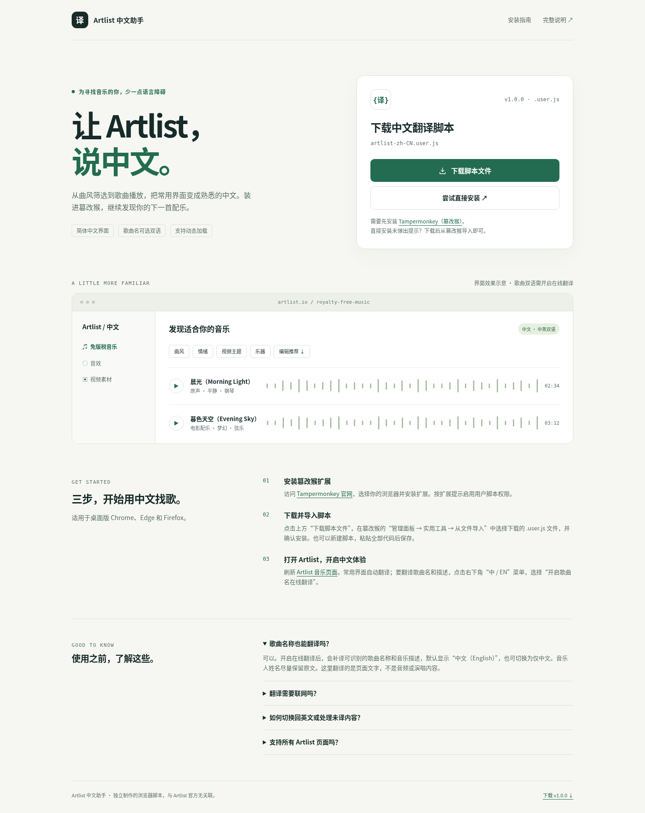

# Artlist 简体中文翻译脚本

主文件：`artlist-zh-CN.user.js`，用于桌面浏览器的 Tampermonkey（篡改猴）。

## 下载与安装

### [⬇ 点击下载 Artlist 中文翻译脚本 v1.0.0](https://github.com/sudazz777/WangZhanFanYi/raw/refs/heads/main/artlist-zh-CN.user.js)

| 下载内容 | 入口 |
| --- | --- |
| 篡改猴脚本（推荐） | [下载 artlist-zh-CN.user.js](https://github.com/sudazz777/WangZhanFanYi/raw/refs/heads/main/artlist-zh-CN.user.js) |
| 完整项目，包含 HTML 下载页面 | [下载项目 ZIP](https://github.com/sudazz777/WangZhanFanYi/archive/refs/heads/main.zip) |
| 脚本源码 | [查看代码](./artlist-zh-CN.user.js) |

**安装：** 先安装 [Tampermonkey（篡改猴）](https://www.tampermonkey.net/)，再点击上方脚本下载链接。如未弹出安装窗口，请保存文件，在篡改猴 **管理面板 → 实用工具 → 从文件导入** 中选择该文件。

安装后刷新 [Artlist 音乐页面](https://artlist.io/royalty-free-music)。要翻译歌曲名和描述，在右下角 **中 / EN → 开启歌曲名在线翻译** 中开启。此功能需要能访问 Google 翻译；常用界面使用本地词库。

<details>
<summary>查看独立下载页面效果图</summary>



</details>

## 下载页面

仓库根目录的 [index.html](./index.html) 是中文下载页面，提供脚本下载、直接安装入口、界面效果示意和安装指南。**GitHub 中点击 HTML 文件会显示源码；在仓库首页直接使用上方下载入口即可。** 若要打开独立网页，请下载完整项目并解压，用浏览器打开 `index.html`，或将项目放到静态服务器上；页面与 `.user.js` 文件需放在同一目录。

如需通过 GitHub Pages 访问网页，在仓库 **Settings → Pages → Build and deployment** 中选择 **Deploy from a branch**，再选择包含本页面的分支及 **/ (root)**，保存即可。私有仓库能否启用 Pages 取决于 GitHub 套餐；仓库下载入口不依赖 Pages。页面使用相对链接，支持仓库子路径部署；当前尚未启用线上网页托管。

## 安装

1. 在 Chrome、Edge 或 Firefox 中安装并启用 Tampermonkey。
2. 点击扩展图标 → **添加新脚本**，删除编辑器原有内容。
3. 用文本编辑器打开 `artlist-zh-CN.user.js`，复制全部代码粘贴进去，按 `Ctrl+S` 保存。
4. 打开或刷新 <https://artlist.io/royalty-free-music>。

也可在 Tampermonkey 的 **管理面板 → 实用工具 → 从文件导入** 中选择这个 `.user.js` 文件。Chrome / Edge 如提示用户脚本未获授权，请按 Tampermonkey 提示启用“允许用户脚本”（旧版可能要求扩展程序开发者模式）。

## 使用

- 安装后自动翻译常用导航、曲风、情绪、视频主题、乐器、筛选、排序和播放器文字。新增列表、弹窗、滚动内容及站内页面切换会重新扫描。
- 右下角 **中 / EN · Artlist 中文** 是折叠菜单，也可通过篡改猴的脚本菜单切换。
- **开启歌曲名在线翻译**：阅读提示后确认，开始补译可识别的歌曲名、音乐描述和音乐正文。默认显示 `中文（English）`；可在菜单切换为仅中文。
- 在线翻译默认关闭，未开启时歌曲名保留原文，常用界面仍然中文。音乐人姓名尽量保留原文，不翻译音频或演唱内容。
- **显示英文原文** 可恢复脚本改动；**重新扫描 / 重试未译内容** 用于网络恢复或新内容未翻译时重试。

## 在线翻译、缓存和限制

在线部分使用 Google 的公开翻译接口，不需要 API Key；需要你的浏览器能访问 `translate.googleapis.com`。该接口不是有服务保证的付费 API，可能限流、变更或无法连接，尤其某些中国大陆网络环境。连续失败三次后会暂停请求，检查网络后点击重新扫描。本地词库不受影响。

开启在线翻译后，符合条件的页面文字会发送给 Google，翻译结果存入篡改猴本地存储，最多保留 2,500 条。请求不携带登录 Cookie；脚本不读取输入框的值，不发送搜索词、密码或可编辑区域的文字，并跳过可识别的表单、账户及账单区域。不要在显示私密内容的自定义音乐页面上开启在线翻译。可以用菜单清空翻译缓存；如果在线翻译仍开启，当前页面会重新请求翻译。

本脚本只修改页面显示文本和占位符等展示属性，不更改歌曲链接、搜索条件、播放和下载请求。翻译搜索框提示不代表中文搜索词会自动转换为英文。授权、价格和条款应以 Artlist 原文为准，歌曲名属于机器翻译参考。

已参考公开音乐首页文字，并在本地模拟页面验证动态内容、播放器更新、原文恢复、歌曲双语、缓存、输入内容保护、异步响应及失败重试。**当前环境无法连接真实 Artlist 做浏览器实测，未验证登录后的所有布局。** 歌曲识别同时使用链接路径、语义属性和常见类名；网站结构变化可能需要更新选择器，不能保证整站每处文字都已覆盖。

## 开发验证

安装 Node.js、Playwright 和 Chromium 后，在此目录执行：

```sh
node --check artlist-zh-CN.user.js
node test/browser.test.cjs
```

测试默认使用 `/usr/bin/chromium`。在线请求在测试中使用模拟响应，不依赖真实翻译服务。
