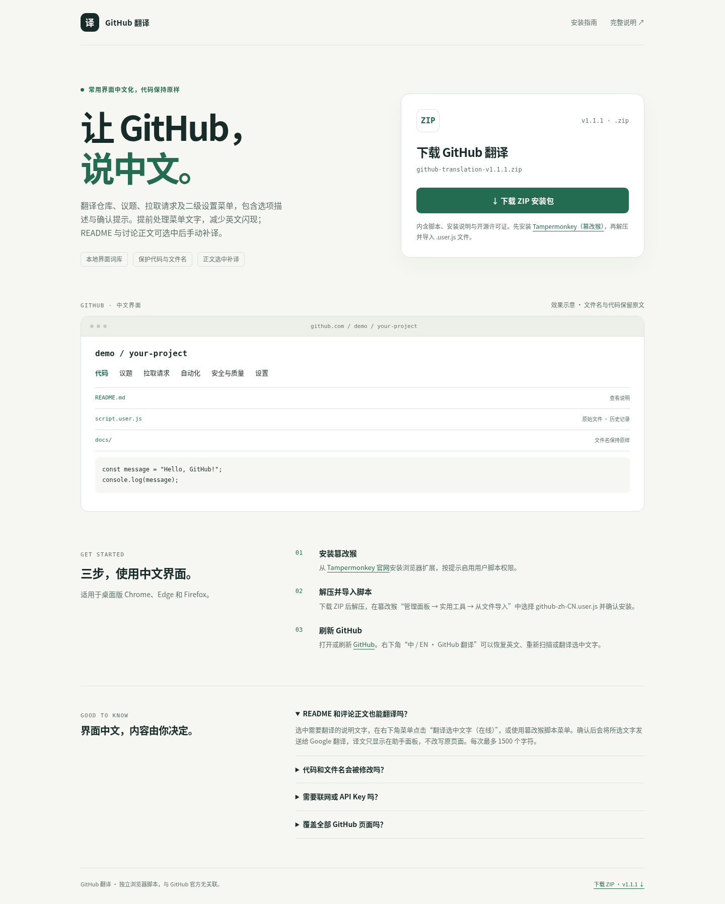

# GitHub 翻译

GitHub 常用界面的简体中文翻译脚本，适用于桌面版 Chrome、Edge 和 Firefox 中的 Tampermonkey（篡改猴）。仅在 `https://github.com/*` 运行，不在 github.dev、github.io 或企业自建域名运行。

## 下载与安装

### [⬇ 下载 GitHub 翻译 ZIP 安装包 v1.1.1](https://github.com/sudazz777/WangZhanFanYi/raw/refs/heads/main/downloads/github-translation-v1.1.1.zip)

压缩包包含 `github-zh-CN.user.js`、`安装说明.txt` 和 `GPL-3.0.txt`。

1. 安装 [Tampermonkey（篡改猴）](https://www.tampermonkey.net/)。
2. 下载 ZIP 并解压，在篡改猴 **管理面板 → 实用工具 → 从文件导入** 中选择 `.user.js` 文件。
3. 确认安装后刷新 [GitHub](https://github.com/)。

这是独立的“GitHub 翻译”，可以与 Artlist、Musicbed 翻译同时安装，设置各自独立。

查看下载页面效果图

## v1.1.1 更新

- 在 `document-start` 启动观察页面，新增的小菜单在浏览器绘制前优先翻译，去掉原来至少 16 毫秒的等待。
- 站内导航保留已有中文，修复先恢复英文、再整页重译造成的闪现；代码行锚点和滚动仍不触发整页扫描。
- 大块新增内容分批处理，每批约 4 毫秒、最多 320 步；尚未完成的新增区域短暂保留布局并隐藏文字，翻译完成后显示，最迟 180 毫秒自动释放。不会隐藏整个 body；关闭中文、处理异常或节点移除时也会清理。
- 提前观察 HTML 的解析和动态插入；助手面板在 DOM 就绪后挂载，并能随页面替换恢复。没有增加翻译服务请求。

## v1.1.0 更新

- 随包提供 117 个设置相关分组、7,238 条静态词条，按当前设置路径加载所需词条；界面翻译仍在本地完成。
- 仓库常规页覆盖维基、议题权限、模板、赞助、讨论、项目、拉取请求、合并策略、网页提交签署声明、源码归档和危险操作的选项与说明。
- 扩展协作者、内容管理、分支与标签保护、规则集、自动化、Webhook、Copilot、模型、环境、云端开发空间、Pages、高级安全、Dependabot、部署密钥、机密与变量、应用、通知及自动链接等二级设置页；并补充账户和组织设置词库。
- 支持标点变体、多句描述、字段与选项的组合；可对齐的跨标签短句保留链接、强调节点和事件。原生下拉选项仅改变显示标签，不改变提交值。
- 校正网页提交签署声明、Git LFS 归档计费和安全功能恢复等说明，确认提示保留仓库标识原有大小写。

## v1.0.1 更新

- 补充全局侧栏中的动态流、所有议题、所有拉取请求、所有仓库、Copilot 助手、MCP 注册表和智能体。
- 补充仓库设置侧栏、模板仓库、默认分支说明、版本不可变性、社交分享预览和维基说明。
- 收窄代码保护范围，允许旧版页面容器和页面级禁用机翻的布局翻译固定控件；仍保留其中的代码、用户正文和输入值。
- 修复被快捷键节点拆开的搜索提示，保留原快捷键与按钮行为。

## 界面翻译

- 仓库导航、分支、标签、提交、文件操作、版本发布和附件等常用控件。
- 议题、拉取请求、评论编辑器工具栏、审查、合并、筛选与计数标签。
- Actions 工作流、运行状态、作业和构建产物入口。
- 仓库设置、Pages、协作者、权限、机密和变量，以及常见账户设置入口。
- 搜索提示、弹窗菜单、站内导航和新加载的控件。

界面词库在本地完成翻译，不需要联网请求翻译服务。匹配收录的完整文字及可以完整识别的句子组合；品牌名、技术标识和未匹配内容保持原文。设置词库不会用于任意仓库正文。

脚本跳过可识别的代码、差异、日志、编辑区、文件名、分支、用户名、仓库名、议题标题、提交说明、README 和评论正文。不修改输入值、链接、分支参数或按钮操作，避免将用户内容误当成固定界面。

## 选中文字手动补译

1. 在 README 或讨论正文中选中需要翻译的文字，每次不超过 1500 个字符。
2. 打开右下角 **中 / EN · GitHub 翻译**，点击 **翻译选中文字（在线）**；也可使用篡改猴脚本菜单中的同名命令。
3. 查看原文预览并确认，才会发送所选文字至 Google 翻译。
4. 译文显示在助手面板内，不替换原始正文，可用 **清空翻译结果** 移除。

不会自动上传仓库、整页、README 或评论。代码和输入区不支持选中补译；所选范围包含这些区域时会提示重新选择。在线请求仅包含选中文字，不携带 GitHub 登录 Cookie，不把所选文字或译文写入篡改猴缓存。

在线补译需要能访问 `translate.googleapis.com`，不需要 API Key；公开接口可能连接失败或限流，不影响本地界面词库。界面语言开关会保存到篡改猴本地设置。

## 切换与性能

右下角菜单可 **显示英文原文**、**恢复中文界面** 或 **重新扫描界面**。新增内容和展示属性变化采用局部处理，大页面分批让出主线程；不因滚动或纯样式变化重扫整页。支持 GitHub 常见 Turbo/PJAX 导航及路径变化。v1.1.1 改为提前启动和绘制前优先处理小块变化，导航不再把中文先还原成英文；较大新增区域的局部等待有 180 毫秒上限。

## 验证范围

已读取公开的 [仓库页面](https://github.com/octocat/Hello-World) 和 [议题列表](https://github.com/octocat/Hello-World/issues) 的实际 HTML，并在离线浏览器中验证导航翻译及文件、议题标题、作者内容保护。另已通过模拟仓库、差异、日志、手动正文翻译和 1,800 行列表性能测试。v1.1.0 的独立设置用例覆盖 30 类路径、122 段菜单和描述，检查截图文案、确认框、跨标签链接、原生下拉提交值、词库路径切换和原文恢复。另通过首次动画帧、12 次动态菜单写入、4 次站内导航、局部遮罩超时/关闭释放和样式恢复测试。未获取登录后的真实设置页 DOM。

未完整实测登录后的所有页面。扩展注入被浏览器延迟、未知文案或超大页面超过等待上限时，仍可能短暂显示原文；无法保证所有环境绝无闪现。GitHub 更新组件、类名或文案可能需要补充词库或保护规则，不能保证每处文字都覆盖。对于代码、技术标识和重要操作含义，以英文原文为准。

## 开源许可

GitHub 翻译自 v1.1.0 起采用 **GPL-3.0-or-later**，ZIP 中附有完整许可证。设置静态词条提取自 [github-chinese](https://github.com/maboloshi/github-chinese) 的固定版本，保留原作者楼教主（52cik）、沙漠之子（maboloshi）的署名，并增加文案校正和本项目的页面处理逻辑。没有执行上游脚本或上游正则规则，也不需要安装其他翻译脚本。词库来源版本和校验值记录在仓库的维护文件中。
