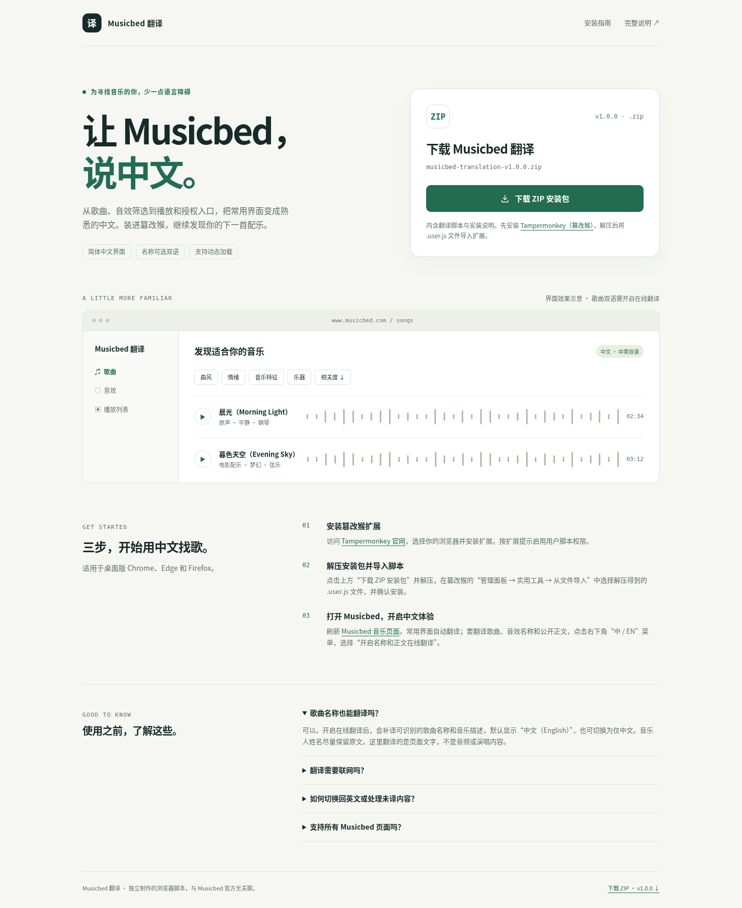

# Musicbed 翻译

用于桌面版 Chrome、Edge 和 Firefox 中的 Tampermonkey（篡改猴）。适用 `musicbed.com` 及 `www.musicbed.com` 的网页。

## 下载与安装

### [⬇ 下载 Musicbed 翻译 ZIP 安装包 v1.0.0](https://github.com/sudazz777/WangZhanFanYi/raw/refs/heads/main/downloads/musicbed-translation-v1.0.0.zip)

压缩包内包含 `musicbed-zh-CN.user.js` 和 `安装说明.txt`。

1. 安装并启用 [Tampermonkey](https://www.tampermonkey.net/)。
2. 下载 ZIP 安装包并解压。
3. 打开篡改猴 **管理面板 → 实用工具 → 从文件导入**，选择解压后的 `.user.js` 文件并确认安装。
4. 打开或刷新 [Musicbed 首页](https://www.musicbed.com/) 或 [歌曲页面](https://www.musicbed.com/songs)。

这是独立的“Musicbed 翻译”，设置和缓存独立于“Artlist 翻译”，可以同时安装。

查看下载页面效果图

## 翻译内容

- 常用导航、注册登录入口、找歌服务、以歌搜歌、播放列表和授权按钮。
- 曲风、情绪、音乐特征、乐器与高级筛选，以及人声、时长和速度等常用标签。
- 歌曲与音效界面的常用控件、详情、版本和播放器。
- 调性和速度文本，例如 `Db major → Db 大调`、`90 BPM → 90 拍/分钟`，以及带逗号的曲风标签。
- 动态弹窗、站内切换及滚动加载的新内容。

默认使用本地词库，歌曲、音效名称和音乐人姓名保留原文。搜索框提示可以翻译，但不会把你输入的中文搜索词自动转成英文。

## 可选在线翻译

点击右下角 **中 / EN · Musicbed 翻译 → 开启名称和正文在线翻译**，阅读提示并确认后，会补译可识别的歌曲、音效名称及部分公开正文。名称默认显示“中文（English）”，可切换为仅中文。音乐人姓名尽量保留原文，不翻译音频或演唱内容。

在线翻译默认关闭。开启后，符合条件的页面文字会发送至 Google 翻译，需要能访问 `translate.googleapis.com`；该公开接口可能连接失败或限流。本地词库不受影响。请求不携带登录 Cookie，结果保存在篡改猴本地存储，最多缓存 2,500 条。

脚本不读取输入框的值，不发送密码、搜索输入或可编辑区域的内容，跳过可识别的表单、账户、个人项目和结算区域。在线翻译主要用于公开首页、歌曲、音效、公开播放列表及分类页面。不要在含有私密资料的自定义页面开启在线补译。

菜单支持 **显示英文原文**、**重新扫描 / 重试未译内容** 和清空翻译缓存。网络恢复后可以手动重试。

## 性能与验证范围

沿用 Artlist 已验证的分批处理：只扫描新增或变化内容，忽略翻译自身的回写和纯样式变化，大页面分批让出主线程；在线补译按内容是否进入可见区域触发，滚动不再遍历整页。

已参考公开的 [首页](https://www.musicbed.com/)、[歌曲列表](https://www.musicbed.com/songs)、[歌曲详情](https://www.musicbed.com/songs/still-home/92947)、[音效](https://www.musicbed.com/sounds) 和 [播放列表](https://www.musicbed.com/playlists) 页面文字及链接路径，并通过本地模拟浏览器验证主要功能与大列表性能。**当前环境无法连接 Musicbed 进行真实浏览器测试，未验证登录后的全部页面。** 网站结构变化可能影响识别，不能保证每处文字均已覆盖。

脚本只修改显示文本和展示属性，不修改歌曲链接、筛选参数、输入值、播放或下载请求。Musicbed 的授权、价格和法律条款请以英文原文为准。
